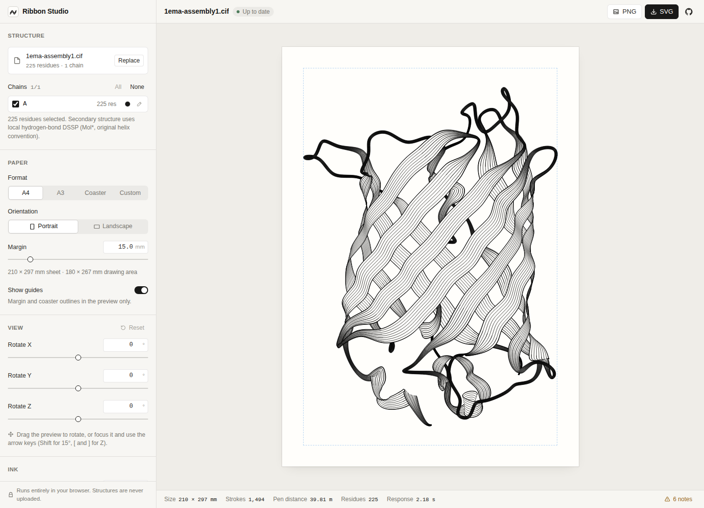

# Ribbon Studio

Turn local protein structures into editable, line-only SVG artwork for a pen plotter. A minimal **Nuxt 4 / Vue / UnoCSS** studio wraps a **Rust/WebAssembly** rendering engine.

**[Open the live studio →](https://select.github.io/ribbon-protein/)** · [Source on GitHub](https://github.com/select/ribbon-protein)

Inspired by Michael Fogleman's [plotter work](https://www.michaelfogleman.com/plotter/) and [original ribbon repository](https://github.com/fogleman/ribbon). This is a separate browser-based implementation, not his Go library.

**Files stay in your browser.** Mol* parses coordinates and computes secondary structure locally; a persistent Web Worker keeps the Rust/WASM renderer and prepared geometry in memory. Nuxt/Nitro only serves the app and its assets—there is no upload or calculation endpoint.

## Studio preview



*The live studio rendering [GFP (PDB 1EMA)](https://www.rcsb.org/structure/1EMA), calculated entirely in the browser.*

## Run locally

Requires Node.js 24, pnpm 11, Rust (stable) and wasm-pack:

```bash
rustup target add wasm32-unknown-unknown
cargo install wasm-pack --version 0.13.1 --locked
pnpm install
pnpm dev
```

Open the URL printed by Nuxt (normally `http://localhost:3000`). `pnpm dev` builds the WASM module first. After changing Rust, run `pnpm build:wasm` and reload the page; Vue/TypeScript changes use normal Nuxt hot reload. `pnpm dev:nuxt` skips the initial WASM build.

### Production

```bash
pnpm build
node .output/server/index.mjs
```

Alternatively, `pnpm generate` creates a static app in `.output/public/`; serve that directory over HTTP(S). No Rust runtime or calculation server is needed on the host. For a custom subdirectory deployment, set `NUXT_APP_BASE_URL` at build time (and when running a Nitro server), for example `/studio/`.

### GitHub Pages

The [Pages workflow](.github/workflows/deploy.yml) builds and deploys [the live studio](https://select.github.io/ribbon-protein/) on pushes to `main`, or manually via **Actions → Deploy to GitHub Pages → Run workflow**. Repository **Settings → Pages → Build and deployment → Source** must be **GitHub Actions**. It uses Node 24, the pinned pnpm lockfile and Rust/wasm-pack; generated assets are uploaded as a Pages artifact, never committed.

To reproduce the Pages build:

```bash
GITHUB_PAGES=true pnpm generate
```

This selects the GitHub Pages preset and `/ribbon-protein/` base path, including the worker, examples and WASM assets. Local development still defaults to `/`. The artifact is `.output/public/`; serve it mounted at `/ribbon-protein/` to test locally.

## Using the studio

1. Choose or drop a `.cif`, `.mmcif`, `.pdb` or `.ent` file. **Load example** opens a small public crambin (1CRN) backbone bundled with the app, without contacting a molecular database.
2. Select protein chains and non-protein components, with optional per-component pen colors. Group controls toggle and recolor all lipids, other molecules, DNA/RNA/other polymers, single atoms or water at once, including currently hidden members. Lipids start in red with an independent **Lipid stroke** width (initially 0.4 mm, matching **Default pen width**; independently adjustable afterward); water is hidden initially.
3. Choose paper, orientation and margin:
   - **A4:** 210 × 297 mm.
   - **A3:** 297 × 420 mm.
   - **Bierdeckel / Coaster:** 93.14 × 93.14 mm canvas containing one 92.74 mm rounded-square guide with 10 mm corners, extracted from the supplied plotter template. Default artwork margin: 5 mm.
   - **Custom:** explicit width and height; swap dimensions to rotate the page.
4. Drag the paper for a lightweight, actual-3D contour preview; release to refine the exact drawing. Or adjust X/Y/Z rotation. With the preview focused, use arrow keys, Shift for 15° steps, `[` / `]` for Z, and Home or `0` to reset.
5. Set **Protein interior lines** (0–20) and **Pen width** (0.1–2 mm; default 0.4 mm). In **Ink**, matching **Protein drawing**, **Lipids drawing** and other molecular groups hold the drawing controls. Protein loop fill, loop/border spacing and border passes live under **Protein drawing → Loop and border settings**. **Advanced** holds spline samples and path direction.
6. Download **SVG** for plotting/editing or **PNG** for a white-paper preview. Only the current, exact full-quality result can be exported—not a stale result or interaction preview. **Cancel** interrupts the worker; the next render restores the normalized structure without parsing or assigning DSSP again.

Guides belong to the preview and are **never exported**. The coaster export is a square SVG canvas, not a mask or a cutting template. The default 5 mm margin keeps the artwork inside the rounded guide; reducing the margin can put ink outside the physical coaster near its corners.

### Plotter semantics

SVGs contain visible vector centerlines, grouped by pen color, with physical millimeter dimensions. There are **no filled surfaces, masks, clipping paths, fonts or embedded raster images**. Temporary protein ribbon and molecular bond-band surfaces are only used for geometric hidden-line removal.

Pen width changes preview/export stroke width; your physical pen determines actual ink width. It does not automatically change loop or border spacing. The independent lipid stroke width affects preview, SVG and PNG; for physical plotting, use a matching pen or a plotter tool that expands strokes—SVG stroke width alone does not create extra pen passes. Under **Ink**, each non-protein drawing group’s **Interior lines** adds real, separate vector paths between the two bond outlines, and **Bond width** sets the full artistic band width in Å (0–4, not an atomic radius). These settings are independent of protein lines and of other molecular groups. Set bond width to 0 for the original single wire per bond; at positive width, 0 interior lines gives two outlines. Lipids default to 0 interior lines and 0.4 Å width; other molecules default to 1 interior line and 0.5 Å width. Isolated-atom circles do not gain interior tracks. Thick pens and closely spaced tracks can overlap—try a small physical sample before plotting. The default `backbone` path ordering retains source direction and smooth joins; `travel` allows reversal to reduce pen-up travel. Neither intentionally bridges real backbone gaps.

## Calculation and limitations

- First molecular model only. Original author chain IDs are preserved. Incomplete protein backbones, sequence/CA/peptide gaps and alternate conformers are handled explicitly. At least four complete residues are needed for a drawable fragment. Non-proteins (lipids, ligands, sugars, cofactors and nucleic acids) use heavy-atom covalent bond lines; atoms without a retained bond use small outline circles. Molecule-only files are supported. Water is optional and hidden initially; hydrogens are omitted. Biological-assembly expansion is not performed.
- **Molecular connectivity stays local:** Mol* uses file-supplied connectivity/component definitions and local tables, with distance inference where unavailable. Each covalent bond is drawn as an artistic band (or a wire at zero width), not an order-specific chemical diagram; no element labels are added. Alternate conformers are selected coherently per residue by summed occupancy (lexical ties), retaining shared blank-alt atoms. Missing atoms are never reconstructed. Separate non-polymer residues are not joined, including covalent links between components; metal coordination and hydrogen bonds are not drawn. Bond bands trace connected degree-two chains and closed rings with smooth circular transitions and real rounded terminal contours (including nested paired interior tracks). Branches use bounded outline joins and carry interior tracks through the shared-atom junction: neighboring half-tracks connect with short curves, and an odd middle track meets at the atom. Junctions also occlude strokes behind them, without SVG fills or new chemical bonds. Extremely tight projected turns locally narrow to avoid spikes. Caps are generated only at original terminals, never at visibility or sampled-preview cuts. Bond bands and protein ribbons can hide strokes behind their projected silhouettes; zero-width molecular wires do not occlude other strokes. A bond viewed exactly end-on becomes an outline cap. Molecular bond-search, atom/bond counts and outline work are bounded.
- **Secondary structure uses local hydrogen-bond DSSP with Mol* stages**, computed from coordinates even without HELIX/SHEET annotations. Chemical residue identities (including proline), coherent conformers and peptide breaks are retained; all selected fragments share hydrogen-bond contacts, including inter-chain sheets. Original helix conventions are simplified as H/G/I → H and E/B → E. Incomplete backbones, unusual residue chemistry, helix boundaries and beta-bulge conventions can still differ between DSSP implementations. Computation failures are errors, never a silent all-loop fallback. See [assignment details and public reference comparisons](docs/web-dssp.md).
- Rust handles ribbon smoothing, continuous loop/ribbon tracks, inset borders, projection, spatially indexed hidden-line trimming, stroke welding/joining, simplification and ordering. This is an artistic ribbon illustration, not a molecular surface renderer.
- Visibility uses **average panel depth**, so intersecting or strongly twisted surfaces may have local occlusion artifacts. PCA orientation, full-precision geometry, page fitting and secondary-structure assignment all affect the final illustration.
- Dragging uses bounded 3D contours without hidden-line removal; **Preview · exports paused** identifies this approximate view. Release computes the unchanged full-quality artwork (**Refining**). Discrete controls are debounced; obsolete requests are coalesced rather than restarting the worker. Exact rendering is not guaranteed realtime.
- **Response** measures options/file-to-result latency, including debounce and queue wait; once the SVG loads it includes an approximate display delay. Hover for WASM-call and stage timings. It is not just Rust compute time or a hardware paint measurement.
- Browser input limits: 20 MiB per file, 250,000 atoms, 10,000 residues, 4,096 selectable components and 512 backbone fragments (including contact-only fragments). The engine additionally caps spline samples, track count, clipping and path-processing work. Oversized drawings fail with a message instead of silently reducing quality. DSSP contact/ladder work is also bounded. Active browser jobs time out after two minutes; waiting in the single newest-request slot does not consume that timeout.
- No multi-structure alignment, G-code, file persistence or account system in this first version. Mol* remains available for future alignment features.

### Protein + lipid example

For a **small membrane-protein test**, download [2B6O.cif from RCSB](https://files.rcsb.org/download/2B6O.cif): the deposited aquaporin-0 (AQP0) structure contains one protein chain (235 modeled residues), nine dimyristoyl phosphocholine (`MC3`) lipid residues and 79 waters, totaling 2,211 atoms. Load the deposited file directly, rather than expanding its larger biological assembly. The lipids appear under **Lipids**; water starts hidden. Some lipids are incomplete, and this single-chain view is not a complete surrounding membrane. The study describes lipid-bilayer organization in two-dimensional crystals; its “double-layered” crystals should not be confused with the two leaflets of one bilayer. See [the structure and publication](https://www.rcsb.org/structure/2B6O). This experimental example needs no cofolding prediction.

For a larger example, download [6BAJ.cif from RCSB](https://files.rcsb.org/download/6BAJ.cif): the *E. coli* AcrB membrane-protein trimer includes 31 phosphatidylethanolamine (`PTY`) residues, 11 hydrocarbon (`D12`) residues and one water. Load the file locally; protein ribbons and molecular bond lines render together. Use the **Lipids** checkbox and color picker to show/hide or recolor all 31 `PTY` components together. Open **Ink → Lipids drawing** and increase **Lipids bond width** to widen the actual bond bands, then set **Lipids interior lines** independently of the protein and other molecules. For example, try 2 Å width, 3 interior lines and a 0.25 mm **Lipid stroke** to see distinct plotting tracks. The stroke setting alone changes ink width, not the number of paths. Many lipids are only partially modeled, so this is not a complete surrounding bilayer. The small `tests/fixtures/6baj-lipid.cif` regression fixture retains one lipid's original coordinates and component bond definitions, with provenance in its header.

## Repository layout

```text
app/                    Vue UI, local parser, worker and state lifecycle
crates/ribbon-core/      Pure Rust renderer, WASM boundary and native tests
public/examples/        Public crambin backbone demo, synthetic data and provenance
public/templates/       Standalone preview-only coaster guide
public/wasm/            Generated wasm-pack output (ignored)
scripts/                WASM build, smoke check and fixture generation
tests/                  Parser, lifecycle, export and real-WASM integration tests
docs/                   Implementation plan and validation notes
output/                 Existing local structures/renders (ignored, not moved)
```

See [performance architecture, exact-output checks and measured before/after results](docs/web-performance.md), [the implementation plan](docs/web-plan.md) for milestone scope, and [validation notes](docs/web-validation.md) for verified checks and rendering limitations.

## Checks and Git hooks

```bash
pnpm build:wasm
pnpm test:wasm
pnpm check              # lint, typecheck, runtime tests
pnpm fmt:check
cargo fmt --all -- --check
cargo clippy --workspace --all-targets -- -D warnings
cargo test --workspace
pnpm build
```

Real-WASM Vitest cases require `pnpm build:wasm`; they are skipped if the generated module is absent. CI builds WASM before running them. Parser regressions use minimal, publicly sourced RCSB backbones with provenance, including 1EZG continuous sheet runs, mixed/helix-rich references, proline chemistry and inter-chain contacts. Native tests cover spline interpolation, interval clipping, stroke continuity, physical dimensions and workload limits, using small committed synthetic fixtures.

`simple-git-hooks` runs lint/format checks before commits and `commitlint` enforces Conventional Commits. Use `pnpm fmt` to format application/config files. Build artifacts, local structure bundles and secrets are ignored and must not be force-added.
